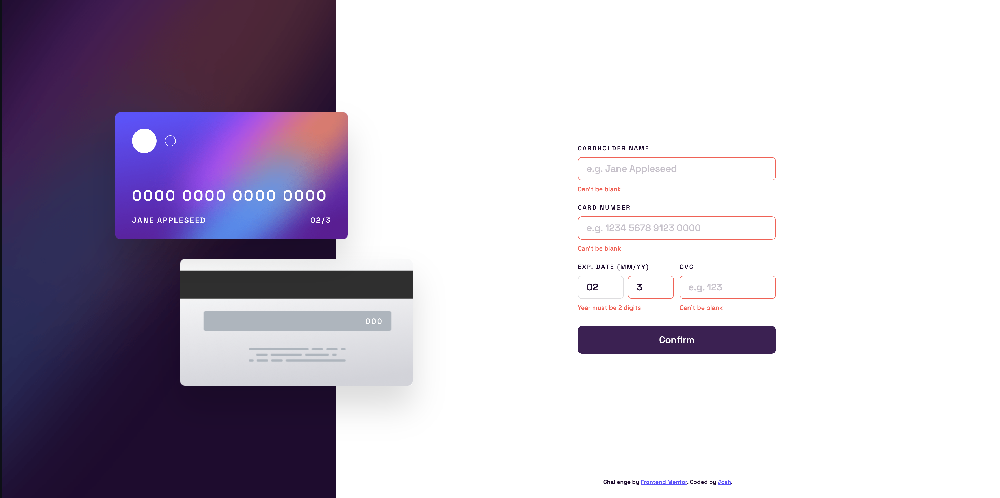

# Frontend Mentor - Interactive card details form solution

This is a solution to the [Interactive card details form challenge on Frontend Mentor](https://www.frontendmentor.io/challenges/interactive-card-details-form-XpS8cKZDWw).

## Table of contents

- [Overview](#overview)
  - [The challenge](#the-challenge)
  - [Screenshot](#screenshot)
  - [Links](#links)
- [My process](#my-process)
  - [Built with](#built-with)
  - [What I learned](#what-i-learned)
  - [AI Collaboration](#ai-collaboration)
- [Author](#author)

## Overview

### The challenge

Users should be able to:

- Fill in the form and see the card details update in real-time
- Receive error messages when the form is submitted if:
  - Any input field is empty
  - The card number, expiry date, or CVC fields are in the wrong format
- View the optimal layout depending on their device's screen size
- See hover, active, and focus states for interactive elements on the page

I also added:

- Card number auto-formatting into groups of four as the user types
- A month range check (01–12) and field-specific messages for the expiry date
- A "Continue" button that resets both the form and the card preview

### Screenshot




### Links

- Solution URL: [Frontend Mentor solution](https://www.frontendmentor.io/solutions/vanilla-javascript---live-card-preview-with-rules-based-validation-IbWWd20ykb)
- Live Site URL: [multi-input-form.vercel.app](https://multi-input-form.vercel.app/)

## My process

### Built with

- Semantic HTML5 markup
- CSS custom properties
- CSS Grid and Flexbox
- CSS container query units (`cqi`) to scale the card text with the card
- Mobile-first workflow
- Vanilla JavaScript

### What I learned

**Live preview from one attribute.** Every input has a `data-preview` attribute holding the id of its spot on the card. One `input` listener on the form updates whichever field changed, so there is no `if` per field:

```js
const previewEl = document.getElementById(input.dataset.preview);
previewEl.textContent = input.value.trim() || defaults[input.dataset.preview];
```

When the page loads, I save each card spot's original text (`Jane Appleseed`, `0000 0000 0000 0000`…) into a `defaults` object. Clearing an input falls back to that value with `||`, and the Continue button loops over the same object with `Object.entries` to reset the whole card.

**Formatting the card number: recompute, don't count.** My first idea was to count keystrokes and add a space after every fourth one, but that breaks on paste, delete, or editing in the middle. Instead, every `input` event rebuilds the value from scratch:

```js
function numberInputFormatter(value) {
  const groups = value.replace(/\s/g, "").match(/.{1,4}/g) ?? [];
  return groups.join(" ");
}
```

`match` returns `null` for an empty string, so `?? []` keeps `join` from crashing when the field is cleared. I keep letters instead of stripping them, so the "Wrong format, numbers only" rule can still catch them. Because the formatted value contains spaces, the number rules remove them before testing: `/^\d{16}$/.test(v.replace(/\s/g, ""))`.

**Anchored regex.** `/^\d{2}$/` means exactly two digits from start to end. Without `^` and `$`, `/\d+/` passes `"12ab34"` because part of it matches. Month uses a separate rule, `/^(0[1-9]|1[0-2])$/`, so `13` gets "Invalid month" instead of a generic format error.

**One shared error line, solved with HTML and CSS instead of more JS.** The design shows one error line under MM and YY. Pointing both inputs at the same element made the second field overwrite the first one's message. Instead of rewriting my validation functions for this special case, I gave each input its own error element and let CSS show only the first visible one:

```css
.field--exp .error-msg:not([hidden]) ~ .error-msg {
  display: none;
}
```

My existing `validateField` worked unchanged. When the user fixes the month, the year's error appears automatically. Since both boxes can be red under one line, I also made the messages name the field ("Month must be 2 digits", "Year can't be blank").

**Two views, one spot.** The completed state replaces the form in the same place, so on success I swap `form.hidden` and `complete.hidden` and move focus to the thank-you message. `form.reset()` belongs to the Continue button, not to the submit handler, so the card keeps the user's details on the thank-you screen.

**`value` vs `textContent`.** Inputs store their content in `value`; elements like `<p>` and `<span>` use `textContent`. Writing `.value` to a card `<span>` changes nothing on the page and doesn't throw an error either.

### AI Collaboration

I use AI as a learning partner to code better, not to skip the learning:

- Used Claude Code to write the HTML and CSS skeleton.
- Used Claude Code to explain the reasoning behind the skeleton's structure.
- Used AI to analyze the product scenario and the key points of the design.
- Wrote all of the JavaScript myself.
- Used AI to build a project notebook, where I manually fill in before, during and after notes (design analysis and planned JS flow, every blocker sorted by type, and a final review compared with similar projects) to organize my thinking, summarize the development process, and correct the mistakes I keep making.

## Author

- Website - [Josh Liu](https://my-portfolio-frontend-kappa-lemon.vercel.app/)
- Frontend Mentor - [@JoshLiu111](https://www.frontendmentor.io/profile/JoshLiu111)
